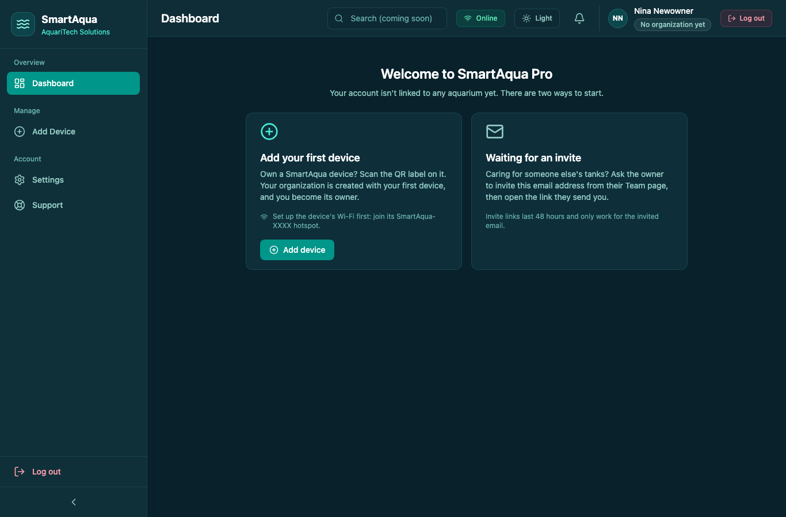
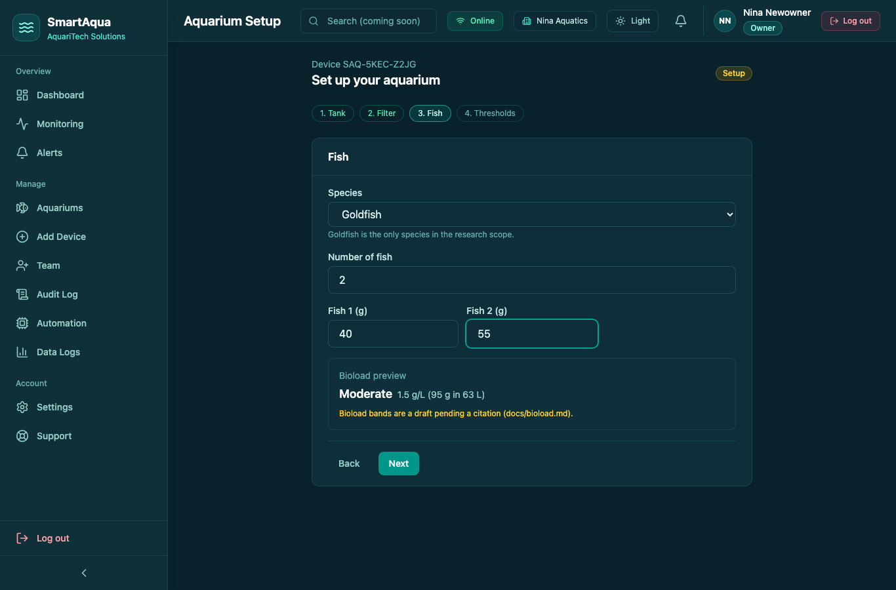
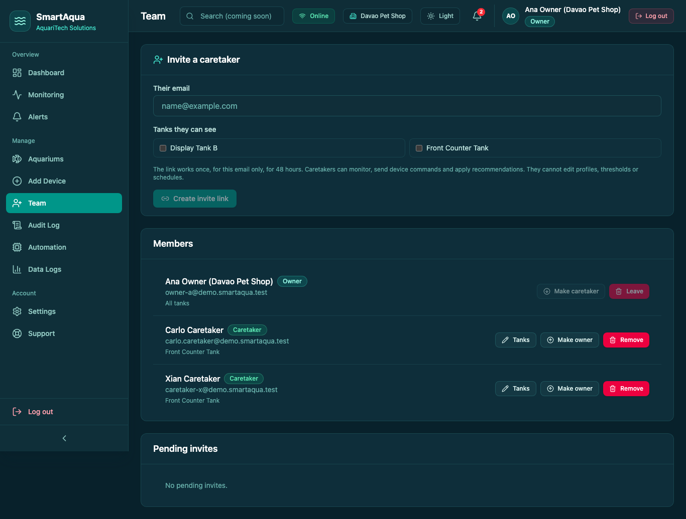
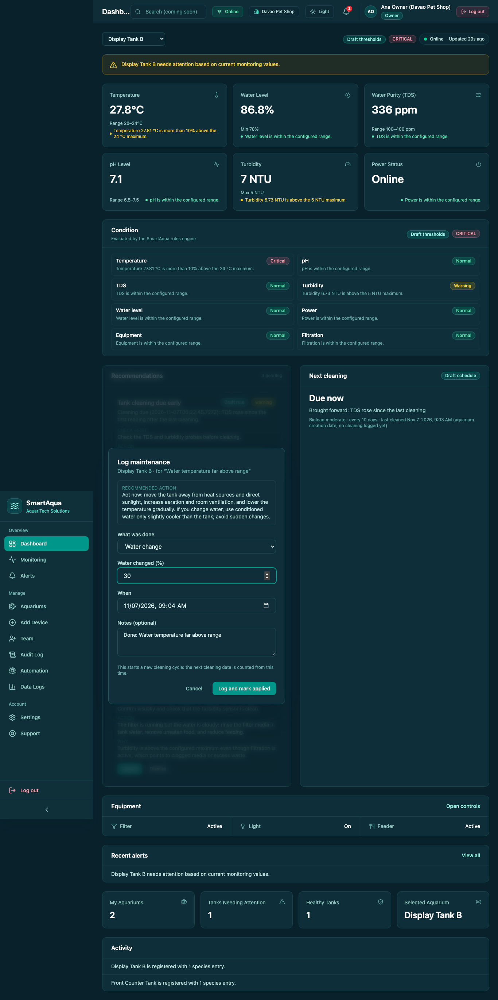
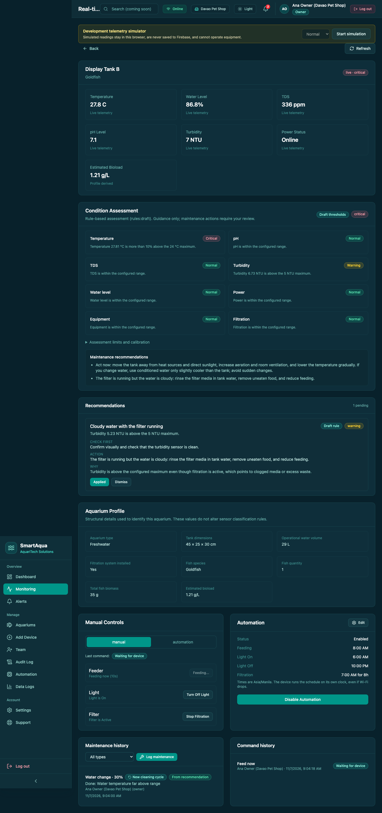
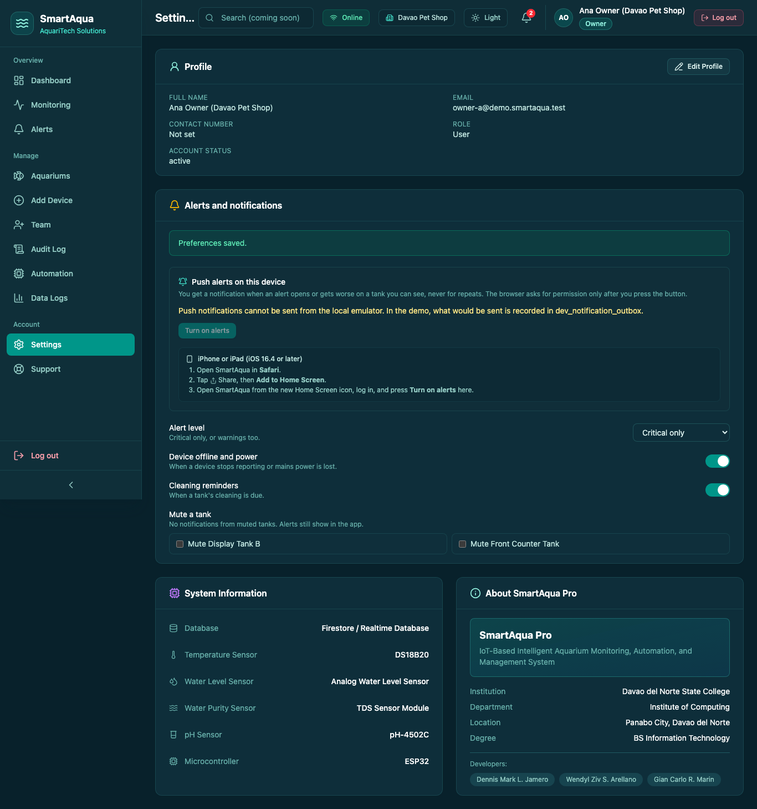
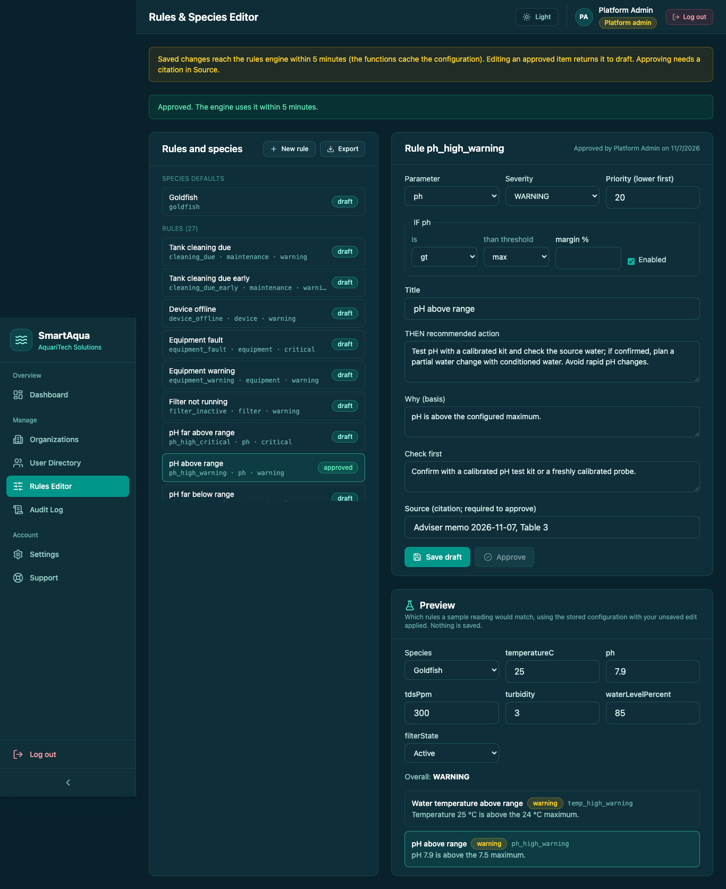
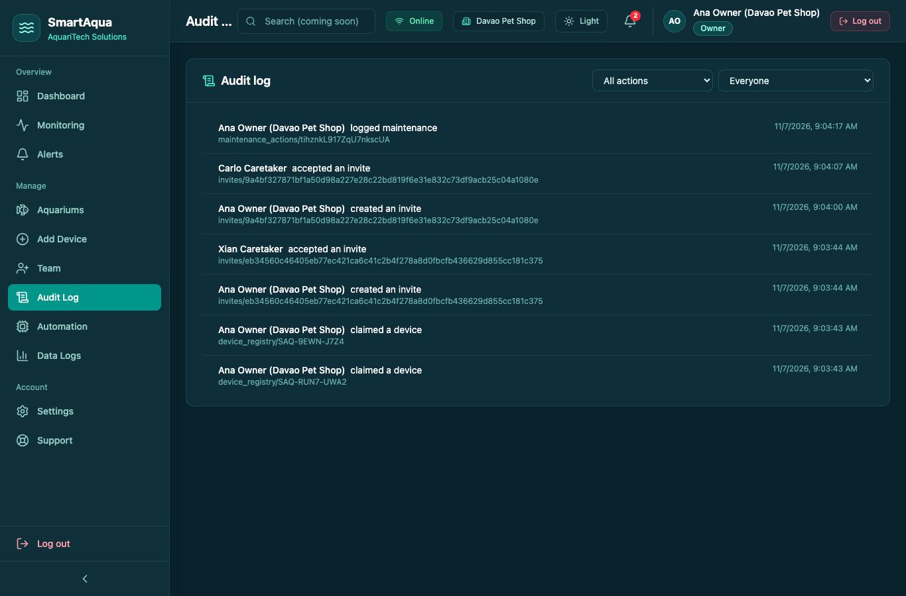

# Running the demo (Emulator Suite only)

`npm run demo` brings up a working, seeded SmartAqua Pro on your machine. **It never touches the live project**: the project id is `demo-smartaqua`, and a `demo-*` id cannot reach real Firebase. The seed script refuses any other id, and it refuses `--project`.

## Steps

1. One-time setup: `npm ci`, `npm --prefix functions ci`, and the Firebase CLI (`firebase --version`; Java is needed for the emulators).
2. Run `npm run demo`. It:
   1. builds the functions;
   2. creates an emulator-only claim-code pepper in `functions/.secret.local` (gitignored) if there is none;
   3. starts the auth, firestore, database and functions emulators (`DATABASE_URL` set so the functions, triggers and rules all use the default RTDB instance `demo-smartaqua-default-rtdb`);
   4. runs `scripts/seed-demo.ts` (below);
   5. starts the demo devices (`scripts/demo-device.ts`), which send a reading every 15 s;
   6. starts `next dev` against the emulators on the first free port from 3000, with its own build folder `.next-demo`.
3. Open the URL it prints, and log in with one of the accounts below.
4. Press **Ctrl+C** to stop everything. Every run starts again from a clean seed.

Options:
- `--no-live`: no demo devices. Tanks show "Device offline" after 60 s, which also demonstrates the offline alert.
- `--port 3100`: use a fixed port.

## What is seeded

| Account (password `SmartAqua-Demo-2026!`) | Role | Sees |
|---|---|---|
| `owner-a@demo.smartaqua.test` | Owner of **Davao Pet Shop** | Front Counter Tank (normal) and Display Tank B (abnormal) |
| `caretaker-x@demo.smartaqua.test` | Caretaker in Davao Pet Shop | Front Counter Tank only |
| `owner-b@demo.smartaqua.test` | Owner of his own personal org | Home Tank |
| `admin@demo.smartaqua.test` | Platform Admin | All organizations (read-only), suspend/reactivate |

- **Rules and species:** the DRAFT goldfish seed (`scripts/seed/goldfish-draft.json`).
- **Devices:** 5 provisioned with `provision-device.ts`. Three are claimed through the real `claimDevice` callable; two stay unclaimed, and their ID and claim code are printed for trying **Add device**. Labels and QR codes are in `provisioning-output/demo-smartaqua/`, and the summary is in `demo-accounts.json` there (all gitignored).
- **Telemetry:** 4 hours of readings, one every 5 minutes, fed through the real ingest pipeline (`functions/lib` `ingestTelemetry`). History, alerts, recommendations and the cleaning schedule therefore come from the rules engine. Display Tank B drifts over its last 90 minutes to CRITICAL temperature and WARNING turbidity.

**This telemetry is demo data**, requested for the demo. It is deterministic (no randomness) and marked `demoSeed` in RTDB. It is never real sensor data, and nothing in the app or functions generates it.

## Playwright smoke tests

`npm run test:smoke` runs the same stack on its own project (`demo-smartaqua-smoke`, port 3100, `--no-live`) and clicks through the key flows (`tests/e2e/smoke.spec.ts`). Screenshots go to `docs/screens/`, which is gitignored except the curated `doc-*.png` used in the docs.

The emulator ports are fixed (`firebase.json`), so stop `npm run demo` before running the smoke tests.

## Screens (from the smoke tests)

| | |
|---|---|
|  |  |
|  |  |
|  |  |
|  |  |
